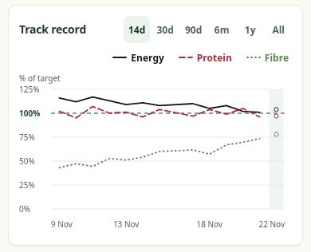
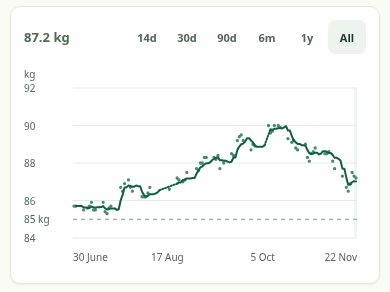

# Plate

I was trying to get leaner without losing muscle. By dinner, I couldn’t tell if I’d had enough protein or whether I was on track for a calorie deficit. And I wasn’t going to look up every ingredient and enter it by hand.

So I built Plate. I can take a photo or say what I ate, get an estimate from ChatGPT, and save it to my log. It was so seamless that I actually kept doing it. Within a few days I was making different choices.

These screenshots use fictional data.

## Before dinner

I check how much protein I still need and how much room I have left. The dotted section shows the energy I’m setting aside for protein. That helps me decide what else to have with dinner.

## After a day over budget

I tap an energy amount in the Food log to put the highest-energy items first. The rib fillet is at the top in this example. I think of steak as protein, but the blue part of the bar shows that just over half its energy came from fat.

## A couple of weeks in

I look at my track record to see whether missing fibre was a one-off or something I do most days. In this example, energy is coming down closer to target, protein is mostly on target, and fibre is improving but still short.

## Across a bulk and cut

The weight chart is where I check if I’m moving in the direction I intended. The individual readings bounce around. The longer view makes it easier to see the bulk and the cut that followed.

## Try it locally

With Node.js 24 or newer, run `npm run demo` and open the address it prints. There’s nothing to install or sign into. The demo uses fictional meals and weights and resets when you reload. Add `?onboarding=1` to try the first-meal flow from scratch.

The interface is plain HTML, CSS and JavaScript, with SVG for the charts. The live app uses a Worker and keeps each account’s log in D1. This repo has the app, tests and sample data, but no live logs or production configuration. For more, see [the design notes](docs/design.md).
