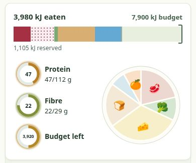
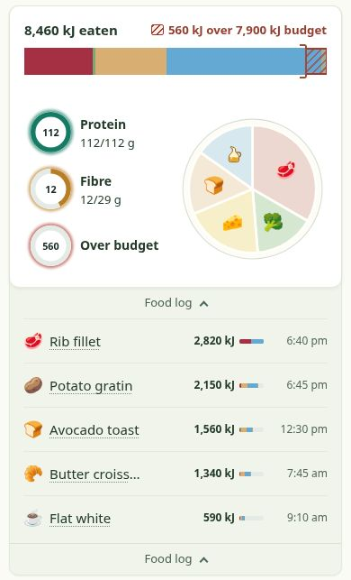
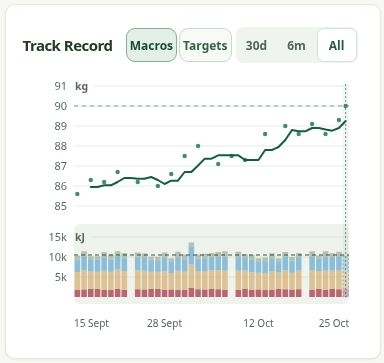
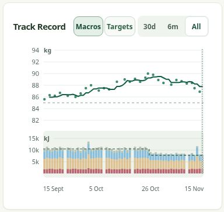
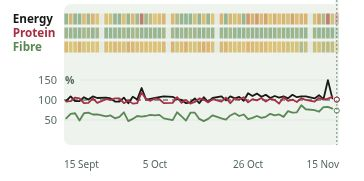
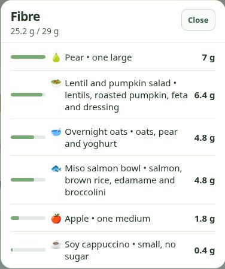

# Plate

I was trying to get leaner without losing muscle. By dinner, I couldn’t tell if I’d had enough protein or whether I was on track for a calorie deficit. And I wasn’t going to look up every ingredient and enter it by hand.

So I built Plate. I can take a photo or say what I ate, get an estimate from ChatGPT, and save it to my log. It was so seamless that I actually kept doing it. Within a few days I was making different choices.

These screenshots use fictional data.

## Before dinner

I check how much protein I still need and how much room I have left. The dotted section shows the energy I’m setting aside for protein. That helps me decide what else to have with dinner.

## After a day over budget

I tap an energy amount in the Food log to put the highest-energy items first. The rib fillet is at the top in this example. I think of steak as protein, but the blue part of the bar shows that just over half its energy came from fat.

## From bulk to cut

I wanted to put on muscle without putting on weight too fast. I raised my energy target, then gave it a few weeks. Looking at what I’d eaten next to my weight, I could see I was eating enough to move towards 90 kg.

When I reached 90 kg, I switched to a cut by lowering my daily energy target. A few weeks later, my weight was coming down. A couple of big days stuck out, but getting back to my usual meals kept me moving towards my goal.

Looking at my track record against my targets, I could see that protein was mostly green but fibre was still yellow.

I went back through a few days in my food log and tapped Fibre to see which foods had given me the most.

Pears were up there, so I started having them more often. The fibre tiles started turning green.

I thought tracking calories would be a pain, but logging a meal takes next to no effort, and seeing those small changes pay off makes me want to keep doing it.

## Try the demo

Both options below open the interactive demo. It uses sample meals and weights, resets when you reload, and doesn’t save a personal log or make AI estimates.

**In ChatGPT Sites:** Open ChatGPT Work on the web or desktop and paste this:

> Build a private ChatGPT Site from https://github.com/Waldo000000/plate. Run `node demo/build.mjs` and use the generated `demo/dist/index.html` as the Site’s static homepage. Use the existing demo, not the live backend. Let me preview it before deploying.

**On your computer:** Clone or download this repo. With Node.js 24 or newer, run `npm run demo` and open the address it prints. There are no dependencies to install.

Add `?onboarding=1` to the demo URL to start with the first-meal walkthrough. For more about how Plate is built, see the [design notes](docs/design.md).
