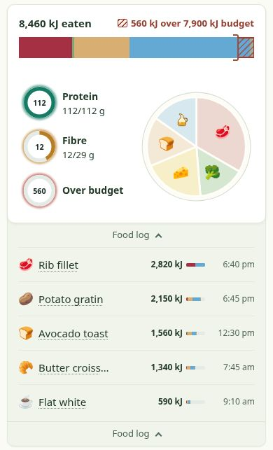

# How Plate works

## From a meal to the dashboard

A typical entry starts with “a bowl of lentil soup and toast” or a photo. The ChatGPT handoff asks for a structured draft with a description and estimated kilojoules for each item. It can also include a meal time, macros and food-group energy allocations. A return link carries the draft in the URL fragment, not the query string. Plate parses and removes the fragment, then previews the entries before saving to the selected day. Pasting the reply and manual entry are alternatives.

The **demo** replaces this external handoff with a canned fictional draft, but uses the same review interface. The actual handoff depends on ChatGPT returning the expected shape; it isn't a nutrition database, and estimates are not measurements.

## What the dashboard is telling you

The macro bar reports energy consumed. A separate visual allowance helps plan for the remaining protein target; it's not a reservation inside the database. The daily plate groups food, while the three rings answer how much protein and fibre are logged and how much of the energy budget is left. Food-group slices represent allocated **energy**, not grams or serving sizes. Expanding food or opening a nutrient detail explains the aggregates without adding clutter to the main view.

Nutrition history normalises each measurement against its own budget or target so different units can share a chart. Weight remains in kilograms. Selecting a day in a chart also selects that day's food log. A missing weigh-in stays missing in storage; a nearby chart estimate is marked as approximate instead of logged as an actual measurement.

## The everyday screens

All four screens use fictional data from the local demo. Use `?shot=next-meal` for the midday example, `?shot=nutrition` for the fortnight, `?shot=high-energy` and pick five days ago for the over-budget day, or `?shot=weight` and select **All** for the bulk and cut.

### Before deciding what to eat


### After a higher-energy day



### Across a fortnight


Track record uses black for energy and the same garnet as the macro bars for protein. The legend toggles each series independently. A band marks the selected day. Today’s logged totals so far appear as hollow circles, separate from the historical lines. The lines connect logged observations across gaps but don’t create entries for unlogged dates. Protein uses the target in effect on each day; energy and fibre are shown against current settings.

### Across a bulk and cut


After onboarding, an inline tip appears the first time a user opens a day with at least two logged foods. It explains how to read the little bars and sort entries by tapping their energy or time. It doesn’t add another step to the first-meal flow.

## What changed in testing

Target setup already asks for a current weight. It now uses that value for one starting weight entry when the chart is empty, instead of asking again. The chart step confirms the recorded weight and points to + → Log weight for tomorrow. A separate muscle-building option starts at 1.6 g/kg/day for adults doing strength training. The energy unit changes how numbers are entered and shown, not the underlying amounts or the chart’s percentages.

## Architecture

```text
Description or photo → ChatGPT draft → browser review → explicit save
                                             │
Plate browser dashboard ─────────────────────┤
Site MCP logging tools ──────────────────────┤
                                             ▼
                                Worker validation and routes
                                             │
                               D1 records scoped by account

Portfolio demo: same UI → local fixture and in-memory mock API
```

- **UI:** plain HTML, CSS and JavaScript. Inline SVG draws charts and the plate; both share the app's selected date. The CSV parser lives in `weight-import.js`.
- **Worker:** `backend.js` validates requests and exposes same-origin browser routes and Sites MCP tools. The production identity header must be supplied by trusted hosting infrastructure; don't expose the Worker behind an endpoint that lets browsers supply their own identity header.
- **Storage:** SQL migrations define dated food and weight records, settings and effective-dated protein targets. The UI can display energy in kJ or kcal; the legacy storage field uses kcal. Food group allocations and CSV exports use kJ. Nutrient data and food-group energy allocations are different dimensions and can be absent independently.
- **Build and tests:** `build.mjs` packages the Worker, inlines the CSV parser and computes content-security-policy hashes. The source snapshot has no deployment credentials, managed project configuration, user logs or production starter-chat link. The local demo does not exercise managed sign-in or D1. Its in-memory settings reset on reload.
